# Architecture

`sisuc` compiles one Sisu source file into one native executable. It is a
pipeline: each stage takes what the previous stage produced and hands on
something closer to machine code. The stages run in one process, with LLVM
linked in as a library. Only the final link runs a separate program, the
system C compiler `cc`.

<picture>
  <source media="(prefers-color-scheme: dark)" srcset="architecture/sisu-pipeline-dark.svg">
  
</picture>

This page stays at the level of stages and the data between them. The code
and its comments hold the detail, and [GLOSSARY.md](../GLOSSARY.md) defines
the terms.

## The stages

**Driver** (`crates/sisuc/src/lib.rs`). Reads the command line, runs the
stages in order and prints diagnostics. The `sisuc` binary (`main.rs`) only
runs it on a thread with a 64 MiB stack. It reads at most 1 GiB of source,
so every span offset fits in a `u32`; a larger file is a tool error. The
fuzzer calls the library too:
`fuzz.rs` runs the `--check` path on raw bytes and asserts that every
diagnostic span and fix edit is well formed. The `--emit` and `--check` flags stop
the pipeline early, as [Developing Sisu](development.md#look-inside-the-compiler)
lists. `--format json` switches the diagnostics to JSON Lines, and
`--explain <code>` prints the explanation of a code and runs no stage.

**Lexer** (`lexer/`). Turns source text into tokens. A line break that can
end a statement becomes a `Newline` token, because statements end at
newlines, not semicolons
([ADR 0001](adr/0001-newline-terminated-statements.md)). It decodes a `char`
literal and its escapes into one scalar value, and a string literal into its
text, so later stages never see the escape text. An integer literal's token
holds only its value; a diagnostic that quotes the literal as written slices
the source with its span. A string with `{expr}` parts
becomes a `StrHead` token, the expression's tokens, and `StrMiddle` or
`StrTail` tokens for the text between and after them. A `:` that ends an
interpolation's expression starts a `FormatSpec` token, which holds the spec's
text. The lexer interns each
name into a `Symbol` (`symbol.rs`), so the parser and checker copy, compare and
hash names as integers; `tir` and diagnostics hold the text as a `String`. After most errors
the lexer skips the bad text and goes on, so it records every one of them,
and the parser keeps the earliest per item. A bracket that is unclosed or does
not match is the exception: the run then reports one diagnostic and the parser
and checker do not run.

**Parser** (`parser.rs`, `ast.rs`). Turns tokens into a syntax tree, the AST.
It reports one error per broken item, then resumes at the next item. The
intact items go on to the checker, and a broken item keeps its name, so a use
of it is not reported as missing. It parses a format spec's text into its alignment, width and precision, and
reports a malformed or unsupported one without breaking its item. It rejects an item that nests deeper than
256 levels, because every later stage walks the tree recursively.

**Front end** (`front_end.rs`). Runs the lexer, parser, checker and last-use
pass in order and returns the program and every diagnostic, in position
order: the checker's are merged in by position. The checker runs only when
every item has a name.

**Checker** (`check/`, `tir.rs`). Resolves every name, types every expression
and lowers sugar: `while`, `while let` and `for` become loops, `?.` and `??`
become `if let`, and `x += 1` becomes `x = x + 1`. A `+=` on a string field
or element, or an assignment that adds to its own field or element place,
becomes an `Append`. A local keeps `Assign` with `Concat` and appends in place
through `concat`'s count-1 path. It folds each top-level `const` to a literal
and replaces every use of its name with that literal. A call to a prelude
function such as `print` or `panic` has its own rule, and `panic(msg)` and
`todo` become a `Panic` node of type `never`. A format spec on a part becomes a padding and a precision, and a precision on a
value that is not an `f64` is an error. A method on a number, such as
`x.sqrt()` or `n.max(m)`, becomes a `Math` node, and a constant such as
`f64.pi` becomes a literal. It reports every error
in one run: an expression that already failed gets the poison type, so one
mistake produces one diagnostic. A program with no errors comes out as the
typed tree, `tir`, which is all that codegen reads.

**Last use** (`last_use.rs`). Walks each function in `tir` backward and turns
every read of a counted local that is its last use into a move. A move hands
over the local's reference instead of sharing it, so a later write to the
array it holds can skip the copy
([ADR 0007](adr/0007-arrays-are-values.md)). The pass reports nothing; the
driver runs it after the checker finds no errors.

**Codegen** (`codegen/`). Walks `tir` and builds an LLVM module through the
[inkwell](https://github.com/TheDan64/inkwell) bindings. Each Sisu function
becomes an LLVM function named `sisu.<name>`, and each method one named
`sisu.<Class>.<method>`. Codegen also emits a `main` with the C signature,
which the C startup code calls and which runs `sisu.main`, passing it `args`,
a `[string]` built from `argc` and `argv`, when `sisu.main` takes that
parameter. Integer overflow
and division by zero call `sisu_panic` instead of wrapping
([ADR 0003](adr/0003-arithmetic-panics.md)). A `Panic` node, which `panic`
and `todo` lower to, calls `sisu_panic_message` with its location and
message, then ends the block with `unreachable`. A `Math` node becomes an LLVM
intrinsic, except `hypot`, which calls `hypot` from `libm`.

Objects live on the heap, with a reference count in front of their fields
([ADR 0005](adr/0005-reference-counting.md)). Codegen lays the fields out
largest alignment first, and fields of equal alignment in declared order, so
less padding sits between them; `tir` and every diagnostic keep declared
order. Codegen emits the helpers that
manage them: `sisu_rc.retain`, and for each class `sisu_rc.release.<Class>`,
`sisu_rc.drop.<Class>` and `sisu_rc.eq.<Class>`, which `==` calls.

An array is one counted heap block too: a header of two `i64`s, the count and
the length, then the elements. Each array type gets the same helpers, such as
`sisu_rc.release.[i64]`, plus `sisu_rc.unique.[i64]`, which copies the block
before a write when another holder shares it. An index out of bounds calls
`sisu_panic_bounds`. Codegen tags the loads and stores of an array's count and
length, and every count update and check, with one TBAA tag, and those of an
array element with another, so LLVM knows that writing an element changes
none of them.

A string is one counted block with a header of three `i64`s: the count, the
length and the capacity, then the UTF-8 bytes. A literal is a private global
that holds a reference of its own, so it is never freed, and each use of it
adds one more. `+` appends in place when the left operand's count is 1,
growing the block through `sisu_realloc`, and copies otherwise, so a literal
is never reused in place: its count never drops to 1 at `+`. An `Append` reads its place, evaluates the text, then checks
the count last, so it appends in place only when nothing else holds the string
or an array on its path. `chars()` and `bytes()` build a new array from the
string, and `string(cs)` encodes a `[char]` into a new block. An interpolation
allocates one block sized for the most text each part can give, plus the width
of each padded part, then writes the parts into it, padding each part in place. With `--rc-checks`, these helpers check each count before they
change it, and `main` calls `sisu_rc_check_exit` before it returns.

**LLVM 22**. Runs the `mem2reg` pass, which turns stack slots into registers,
or with `-O2` the `default<O2>` pipeline. Then it emits x86-64 object code for
the machine `sisuc` runs on.

**Link step** (`link.rs`). Writes the object code to a fresh temporary file
and runs `cc` on it together with `libsisu_runtime.a`. `cc` adds the C
startup code and libc and writes the executable. The temporary file is
removed whether or not the link succeeds.

**Runtime** (`crates/runtime`). A Rust static library with a C ABI, linked
into every program. Generated code calls it to print values, to read lines,
to panic and to allocate and free objects, arrays and strings:
`sisu_print_int`, `sisu_print_f64`, `sisu_print_bool`, `sisu_eprint_int`,
`sisu_eprint_f64`, `sisu_eprint_bool`,
`sisu_flush_stdout`, `sisu_panic`, `sisu_panic_message`, `sisu_panic_bounds`,
`sisu_alloc`, `sisu_realloc` and `sisu_free`. Text lives in `text.rs`:
`sisu_print_char`, `sisu_print_str`, `sisu_eprint_char`, `sisu_eprint_str`,
`sisu_str_compare`, and `sisu_write_int`, `sisu_write_bool` and
`sisu_write_char`, which interpolation calls (`float.rs` adds `sisu_write_f64`
for an `f64`, and `sisu_write_f64_fixed` for one with a precision), and
`sisu_pad`, which pads a part with a width in place, and
`sisu_utf8_count`, `sisu_utf8_decode`, `sisu_utf8_len` and `sisu_utf8_encode`,
which `chars()` and `string(cs)` call, and `sisu_words_count` and
`sisu_word_next`, which `words()` calls; `s.words().len()`, written as one
expression, calls only `sisu_words_count`. `stdin.rs` holds `sisu_read_line`,
which `read_line()` calls. `args.rs` holds `sisu_args_len` and `sisu_arg`,
which the generated `main` calls to build `args` when `sisu.main` takes it.
`print(x)` and `"{x}"` share one formatter per
type. The `sisu_print_*` functions write into a buffer that the runtime owns,
and `main` calls `sisu_flush_stdout` before it returns. The `sisu_eprint_*`
functions write each value at once, in one write to standard error. The
runtime counts the blocks that are allocated and not yet freed. A program
built with `--rc-checks` calls `sisu_rc_fault` when a count check fails, and
`sisu_rc_check_exit` at a normal exit, which fails when that number is not
zero. Both exit with code 102.

**Diagnostics** (`diagnostic/`, `report.rs`). The lexer, parser and checker
report problems as diagnostics. `diagnostic/registry.rs` holds the code table
and every message, label, help and fix: a stage builds a `DiagnosticKind`, and
the registry turns it into a `Diagnostic` with a stable code
([ADR 0013](adr/0013-diagnostics-have-stable-codes.md)). `diagnostic/render.rs`
writes it in the style of `rustc`: the message, the `file:line:col`, and the
source line with the code underlined. `diagnostic/json.rs` writes the same
diagnostic as one JSON line, and `diagnostic/suggest.rs` finds the closest
name for a did-you-mean fix. `report.rs` writes diagnostics and tool errors
as text or JSON, counts them and ends with the summary. Before it writes one,
`front_end::sound_fixes` drops any fix whose result would lex or parse worse
than the input, so no stage has to guard its own fixes. The explanations in
[`docs/diagnostics`](diagnostics/README.md) are what `--explain` prints.

## Updating the diagram

The diagram's source is
[`architecture/sisu-pipeline.json`](architecture/sisu-pipeline.json), written
for the [archify](https://github.com/tt-a1i/archify) diagram tool. After a
change to the pipeline:

1. Edit the JSON.
2. From `docs/architecture`, render it with archify's command-line tool,
   where `<archify>` is your archify checkout, or the directory of the
   `archify` agent skill when it is installed (`~/.agents/skills/archify`):
   `node <archify>/bin/archify.mjs finalize architecture sisu-pipeline.json
   sisu-pipeline.html --quality showcase`. The HTML lands next to the JSON.
   With `ARCHIFY_CHROME` set to a Chrome or Chromium binary, `finalize`
   also runs archify's browser check.
3. Export both SVGs over `sisu-pipeline-light.svg` and
   `sisu-pipeline-dark.svg`: run `ARCHIFY_CHROME=<chrome> node
   export-svgs.mjs`, which clicks the viewer's **Export → SVG · Light** and
   **Export → SVG · Dark** in headless Chrome. Without Chrome, open the HTML
   and use those two menu items by hand.

The rendered HTML is not committed. It is over the 500 KB limit of the
`check-added-large-files` hook, and the JSON regenerates it.
